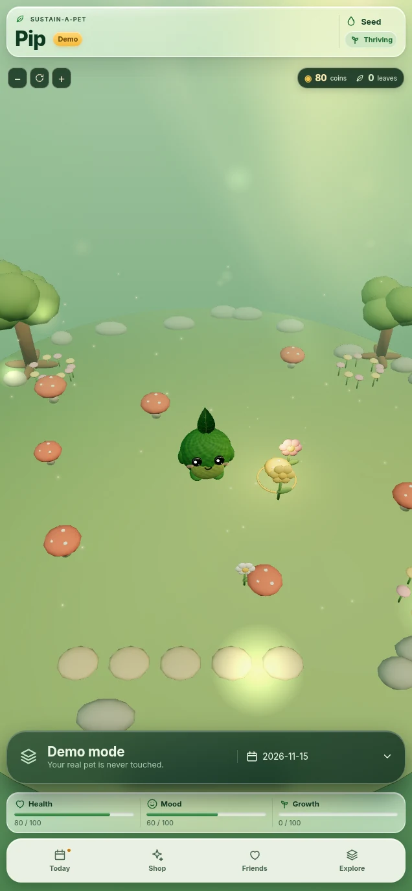
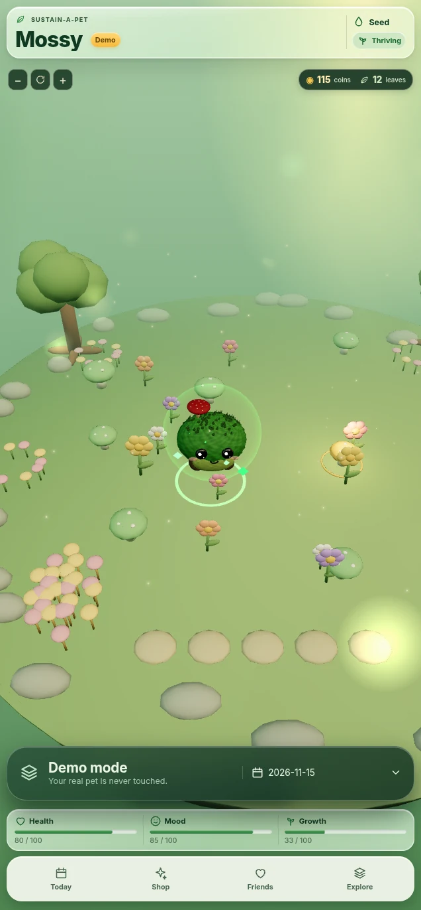
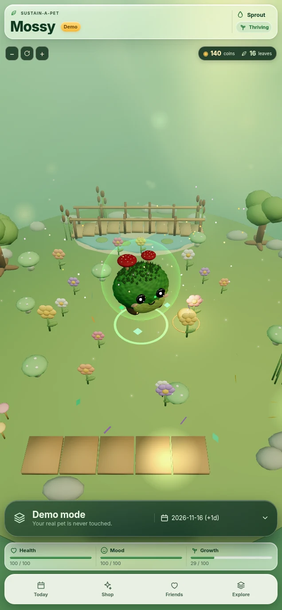
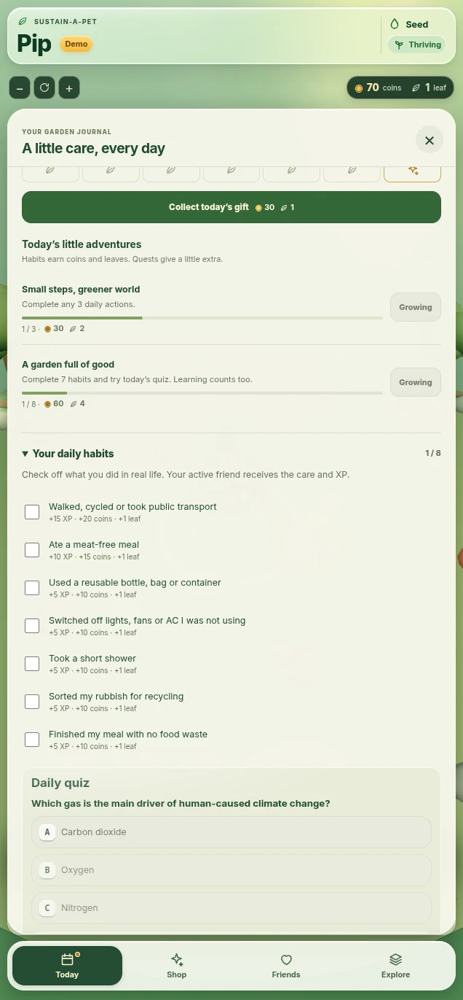

**Live:** <LIVE_URL_TODO>

# Sustain-a-Pet

A virtual pet that grows with small green habits in real life. Pick a companion, explore three garden areas, complete daily habits, answer a quiz, and use the shared garden economy to restore habitats and care for your friends.

Everything stays on your device (localStorage). No accounts, no tracking.

## Screenshots

<p align="center">
  
  
  
  
</p>

## Offline

- No backend. Game state is saved in `localStorage`, with an in-memory fallback if storage is blocked (`src/store.js`).
- The Nunito font is self-hosted through `@fontsource/nunito` (`src/main.jsx`). No Google Fonts request.
- Audio and 3D models ship with the app in `public/`.

## Run it

```bash
npm install
npm run dev      # http://localhost:5173
npm test         # engine + store tests
npm run build
```


## Deploy

See [DEPLOY.md](DEPLOY.md) for DeployXA, Cloudflare Pages, Netlify, and Docker steps, cache notes, and the real-phone test checklist.

## What's built

- Pure game engine (`src/engine.js`): habits, daily decay, mood bands, stages, unlocks, quiz.
- Reducer + saving (`src/store.js`) with an in-memory fallback if storage is blocked.
- Three Blender-authored botanical 3D pets (Leafling, Mossy, Sunbud): embedded albedo and normal textures, four moods, and four growth stages. Editable source and rebuild instructions are in `assets/blender/`.
- Standalone model review: open `/model-preview.html` on the dev server to inspect every character, growth stage, health mood, and floating effect without touching game saves.
- Responsive garden with a mushroom for each daily habit. Select a mushroom and your companion walks over; its checkbox appears when the companion arrives. The Today journal also has a direct habit checklist and the daily quiz.
- Daily gifts and habits are shared across companions and capped once per day. The active companion receives habit and quiz XP, and each companion keeps its own growth progress. The Friends screen is where you adopt and switch companions.
- Shop for care items and decorations, place or put away decorations, and restore the meadow before unlocking the pond and grove. Restoration changes the active garden scene.
- Camera controls: use the on-screen zoom and reset buttons, or `+`/`-`, arrow keys and `0`. Keyboard shortcuts `1`–`7` complete habits, `A`/`B`/`C` answer the quiz, and `P` pats your companion.
- Rewards include a tick bounce and leaf burst, quiz confetti, stage-up cutscene, happy dance and unlock toasts. Motion responds to the reduced-motion preference.

## Practice and progress

Open **Today** to collect the daily gift and review the seven real-life habits and daily quiz. The three-action and all-eight garden quests provide one-time daily bonuses. Use **Shop**, **Friends** and **Explore** to spend coins and leaves, care for or switch companions, visit areas and restore their landmarks.

## GreenLens AI

GreenLens turns a photo and/or a short note (up to 200 characters) into one small, safe, real-world green action. The action is worth 5–15 XP once you confirm you did it.

Architecture:

```
client (GreenLens.jsx, greenLensClient.js)
  -> /api/eco-quest (api/eco-quest.js)
  -> OpenRouter chat completions, free vision model (json_schema response_format = QUEST_SCHEMA)
  -> validateQuest (src/ecoQuest.js)
  -> deterministic game engine (src/game.js, src/store.js)
```

- The client shrinks the photo to 1024 px (JPEG, quality 0.82) and posts it to `/api/eco-quest`. Accepted images: JPEG, PNG or WebP, up to 3.5 MB.
- The endpoint validates input and applies a rate limit of 10 requests per minute. It then calls OpenRouter with a strict JSON-schema response. Free models are slow and flaky, so the upstream timeout is 30 seconds. On 404, 429 or 5xx the endpoint tries the fallback models in order.
- `validateQuest` clamps XP, trims and strips HTML from text, and rejects denied (unsafe) actions. Model output is never trusted as-is.
- The game engine alone changes state. The model cannot grant rewards.

Setup:

```bash
cp .env.example .env   # then set OPENROUTER_API_KEY
npm run dev            # http://localhost:5173
```

- `OPENROUTER_API_KEY` (required): without it, `/api/eco-quest` returns `503 ai_unconfigured`. Habits and quests keep working.
- `OPENROUTER_MODEL` (optional): defaults to the free vision model `nvidia/nemotron-3.5-super-vl:free`. Fallbacks, tried in order on 404, 429 or 5xx: `google/gemma-4-31b-it:free`, then `google/gemma-4-26b-a4b-it:free`.
- Server-side only. Never prefix these with `VITE_` and never import them into client code. The key must not reach the client bundle. `.env` is git-ignored.
- Deployed hosts need `OPENROUTER_API_KEY` in their environment variables.

Safety:

- The user must confirm each action ("Yes, I did it") before any reward.
- XP is capped at 5–15.
- 3 AI quest completions per day (`MAX_AI_QUESTS_PER_DAY`).
- Each quest completes once. Completing it again is a no-op.
- Text in photos or notes is untrusted data and cannot override the system prompt.
- Quests must avoid medical, legal and dangerous advice; the prompt and denylist enforce this.

## AI-use disclosure

- **Claude Code (Anthropic):** development of code, tests and documentation.
- **OpenRouter, free model `google/gemma-4-31b-it:free` (Google Gemma):** runtime. Reads the photo and/or note (vision) and generates quests through `/api/eco-quest`.
- **OpenAI Codex:** named only in a git stash label in `plans/animation-audit.md`; its role is not documented.

_Team: expand this section with who prompted, reviewed and can explain each part._

## Sources

_TODO: list sources for the habit "why" lines and quiz facts._

## License

MIT. See [LICENSE](LICENSE).
